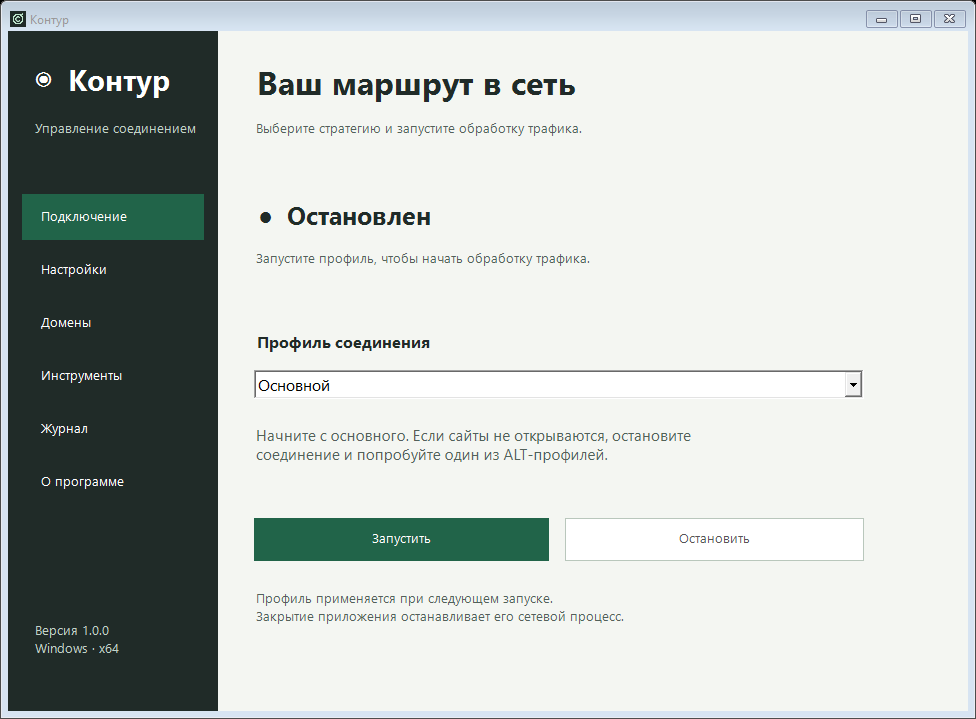

# Контур

Одно приложение для Windows с графическим управлением сетевыми стратегиями.
Скачайте **один EXE** и запустите — распаковывать архив вручную не нужно.

**[Скачать Kontur.exe](https://github.com/FirstRyzen/Zapret-AIUNLOCK-TelegramUnlock/releases/latest/download/Kontur.exe)**



## Запуск

1. Скачайте `Kontur.exe` по ссылке выше.
2. Откройте файл и подтвердите запрос прав администратора.
3. Выберите «Основной» и нажмите «Запустить».
4. Если нужный сайт не открывается, остановите профиль и попробуйте ALT1–ALT13 или другую стратегию.

Все компоненты и лицензии встроены в EXE. При первом запуске приложение
самостоятельно подготавливает их в `%LOCALAPPDATA%\Kontur\runtime`.
Рядом со скачанным EXE дополнительных папок не требуется.
Повторный запуск использует подготовленные компоненты и сохраняет свои домены.
Для подготовки компонентов интернет не нужен; обновление адресов AI — отдельное действие.

Windows x64, .NET Framework 4.8. Дополнительная установка Python, Node или .NET SDK не нужна.
Приложение не подписано цифровой подписью.

## Возможности

- 22 профиля: основной, ALT1–ALT13, EXP, FAKE TLS AUTO и SIMPLE FAKE с вариантами.
- Запуск и остановка собственного winws, вывод ошибок и журнал.
- Игровой фильтр: TCP, UDP, оба протокола; свои порты и диапазоны.
- Редактор добавляемых и исключаемых доменов.
- Сворачивание в трей и запуск выбранного профиля при открытии приложения.
- Отдельные кнопки AI Unlock и Telegram Desktop во вкладке «Инструменты».

«Процесс работает» означает работу движка; доступность сайтов проверяется отдельно.
Настройки применяются при следующем запуске профиля. При выходе Контур останавливает
только запущенный им winws. Другой winws необходимо остановить прежним способом.
Автозапуск при открытии приложения не добавляет программу в автозагрузку Windows.

AI Unlock включает отдельный блок в системном hosts. Отключение удаляет этот блок;
резервные копии сохраняются в `utils/ai-unlock-backups` внутри папки компонентов.
Telegram-прокси — отдельный процесс с собственным треем: при выходе из Контура
он продолжает работать. Остановить его можно кнопкой в «Инструментах».
Его настройки и секрет создаются на компьютере пользователя и не встроены в EXE.

Настройки оболочки и журналы: `%LOCALAPPDATA%\Kontur`.
Домены и настройки прокси: внутри папки компонентов в `runtime`.

## Сборка из исходников

```powershell
powershell -NoProfile -ExecutionPolicy Bypass -File scripts/build.ps1
powershell -NoProfile -STA -ExecutionPolicy Bypass -File scripts/test.ps1
powershell -NoProfile -ExecutionPolicy Bypass -File scripts/build-single.ps1
powershell -NoProfile -STA -ExecutionPolicy Bypass -File scripts/test-single.ps1
```

`build.ps1` собирает оболочку для локальной разработки, которая использует папки репозитория.
`build-single.ps1` создаёт готовый файл **dist/Kontur.exe** со встроенными компонентами.
В него не входят локальные журналы, hosts-бэкапы, секрет Telegram и пользовательские домены.
Контрольная сумма готового EXE — `dist/Kontur.exe.sha256`.
Тест одиночного EXE проверяет распаковку в изолированную папку, 22 профиля,
повторный запуск, сохранение доменов и обнаружение повреждённых компонентов.

## Основа и авторы

Контур — самостоятельное название и новый интерфейс поверх существующего движка.
Используются [zapret / bol-van](https://github.com/bol-van/zapret),
стратегии [Flowseal](https://github.com/Flowseal/zapret-discord-youtube),
[WinDivert](https://github.com/basil00/WinDivert),
[TG WS Proxy](https://github.com/Flowseal/tg-ws-proxy),
адреса [ImMALWARE/dns.malw.link](https://github.com/ImMALWARE/dns.malw.link).
Подробности и лицензии — в `THIRD_PARTY_NOTICES.md` и `licenses`;
в приложении их можно открыть из раздела «О программе».
